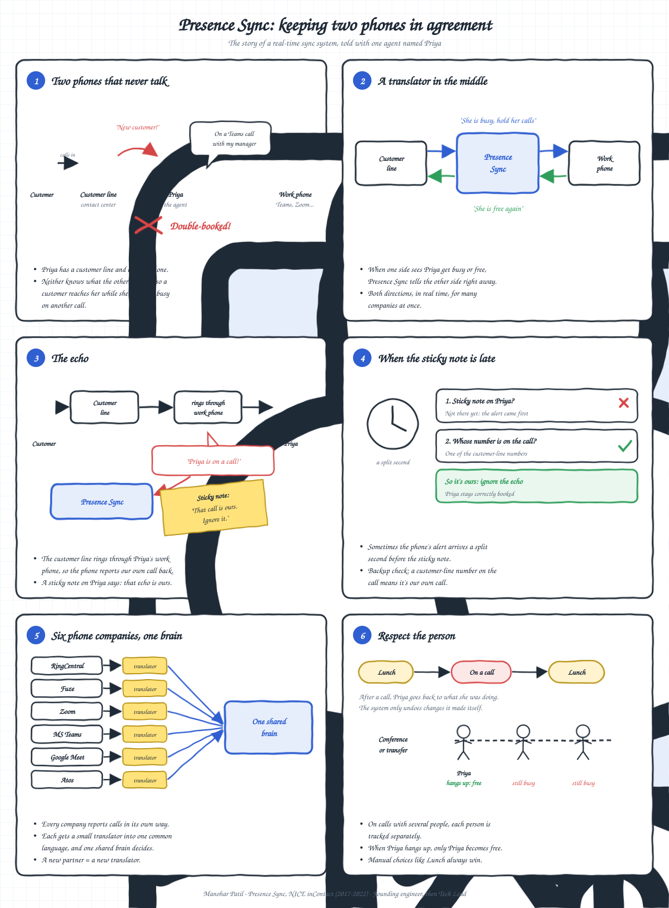
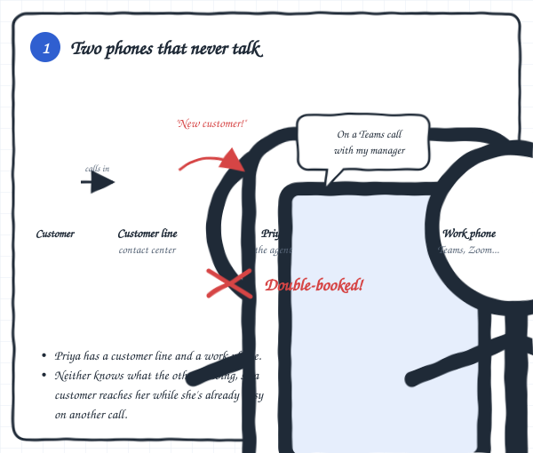
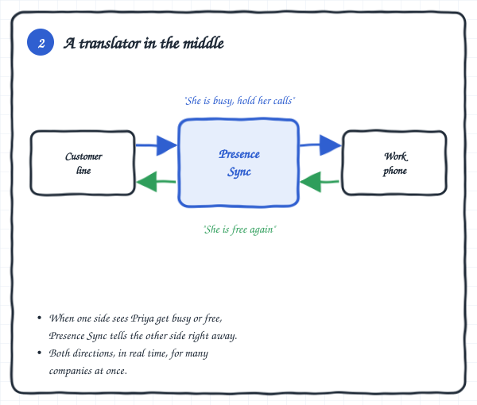
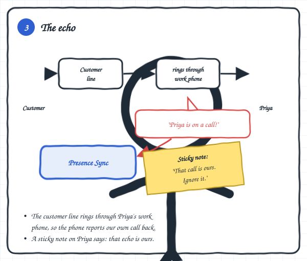
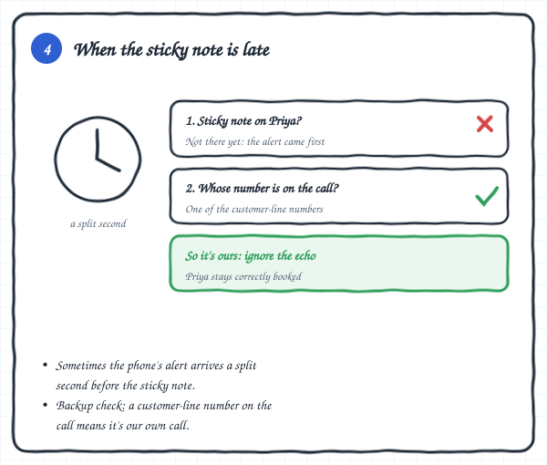
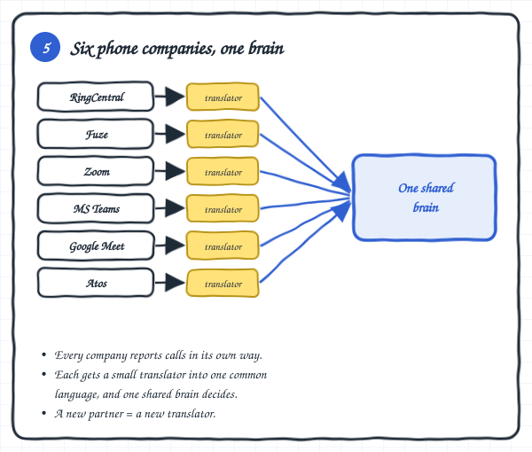
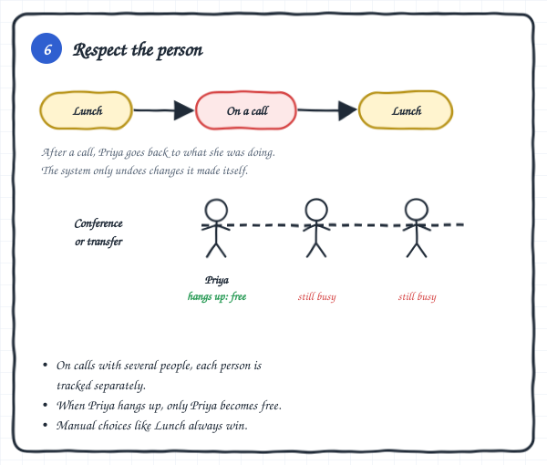
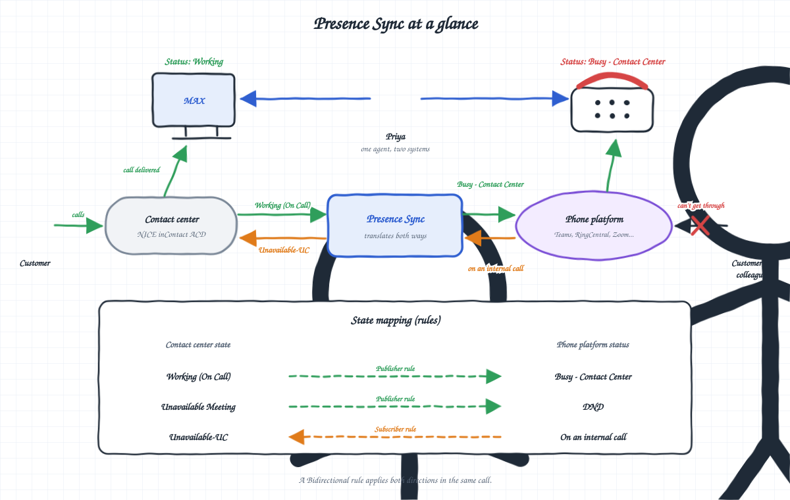
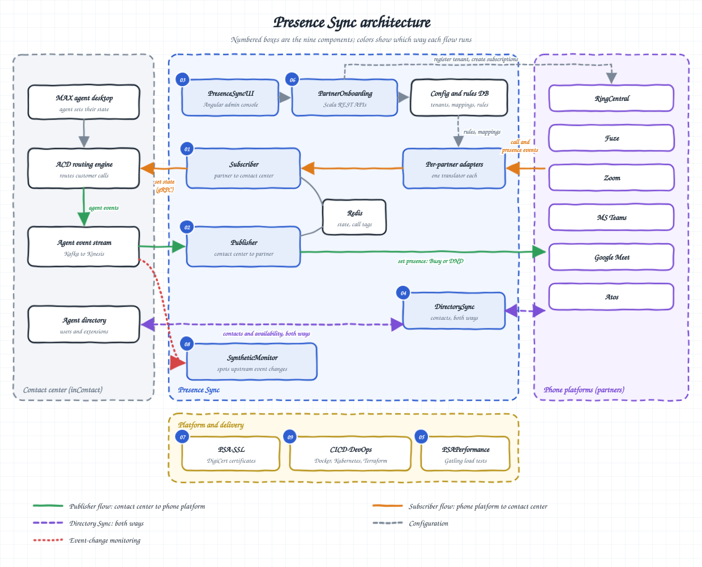

[← All projects](../)

# Presence Sync

**Real-time, two-way agent status sync between a cloud contact center and the phone platforms agents work in.**

|                         |                                                                                                 |
|-------------------------|-------------------------------------------------------------------------------------------------|
| **Company**             | [NICE inContact (now NICE CXone)](https://www.nice.com/)                                        |
| **Years**               | 2017 - 2022                                                                                     |
| **My Role**             | First engineer on the project, then Tech Lead (team of about 20)                                |
| **Public Product Page** | [NICE UCaaS Integrations](https://www.nice.com/products/open-cloud-platform/ucaas-integrations) |

> **In one sentence:** I made two systems I didn't control behave as if they shared one brain, in real time, for 100,000+ agents, and the hard part was teaching the system to tell real events apart from its own echoes.

## Overview

- A contact-center agent, let's call her Priya, gets two kinds of calls.
- **Customer calls** come from the contact center, which decides who is free and sends her the next customer.
- **Internal calls** come from colleagues on her work phone platform (Microsoft Teams, Zoom, RingCentral and others).
- Contact centers used to deliver customer calls to a hard desk phone (a landline). We integrated the contact center with digital phone platforms, so **both kinds of calls now arrive on one phone**.

## The problem

### 1. Two phones that never talk

- The contact center and the phone platform never talked to each other.
- If Priya was on a Teams call with her manager, the contact center still saw her as free and sent her a customer.
- If she was busy with a customer, her work phone still showed "Available".
- Across many companies and many agents, that meant missed customers and wasted time.

## The idea

### 2. A translator in the middle

- Presence Sync is a translator between the two.
- When one side sees an agent get busy or free, it tells the other side right away, in both directions, in real time.
- We owned neither platform, and there was no shared transaction between them, so the two had to be kept in agreement from the outside.

## What made it hard

### 3. The echo

- Customer calls and internal calls arrive on the same phone. The customer line has no handset of its own; it rings through Priya's Teams or RingCentral phone.
- So when a customer call arrives, her work phone announces "Priya is on a call!". A naive system would mistake that for a separate personal call and react to it, like hearing your own voice echo back and thinking someone else is talking.
- My fix: put a "sticky note" (a tag) on Priya whenever the contact center sends her a customer call. Whenever her work phone says she's on a call, the system first checks for the sticky note. If it's there, the system knows it's the customer call it already knows about, and ignores the alert.

### 4. When the sticky note is late

- Sometimes the phone's alert arrives a split second before the sticky note is in place.
- As a backup, I had the system check the number on the call. If it's one of the company's customer-line numbers, the call is ours and the alert is ignored.

### 5. Six phone companies, one brain

- RingCentral, Fuze, Zoom, Microsoft Teams, Google Meet and Atos all report calls differently (PubNub, WebSockets, webhooks, polling).
- Instead of six separate systems, I gave each partner a small translator into one common event format, and one shared brain made every decision. Adding a partner became writing a translator, not building a new system.

### 6. Respect the person

- If an agent sets herself to "Lunch", the system must not flip her back to "Available" after a call.
- Presence Sync only undoes changes it made itself, and returns the agent to whatever she was doing before.
- In conferences and transfers, people join and leave at different times.
- I tracked status per person on the call, so when Priya hangs up, only Priya becomes free.

## My Role

- First and only engineer at the start: learned the contact-center domain, mapped use cases with the Product Owner, designed the baseline architecture and built the first versions.
- Designed the backend end to end, and the onboarding and user-mapping experience (built in Angular by UI engineers).
- Designed DirectorySync, which gave agents a live view of which teammates were free, so they could pull one into a customer call.
- Wrote the gRPC state service (Go server, Scala client) that replaced a REST call on the busiest path.
- With no DevOps team yet, led the move from EC2 to Docker and Kubernetes, and from CloudFormation to Terraform.
- Tech Lead as the team grew to about 20: owned the architecture and design reviews, mentored engineers, and ran a structured handover before moving on.

## Architecture

### At a glance

- **Contact center to phone platform (green):** a customer call puts Priya in Working (On Call) in the contact center, and Presence Sync shows her as "Busy - Contact Center" on her phone platform, so other callers can't get through.
- **Phone platform to contact center (orange):** an internal call on her work phone makes her Unavailable-UC in the contact center, so no customer is routed to her.
- **Rules** map each contact-center state to a phone-platform status, in one direction or both.

### How the components fit together

- Two independent services: a **Publisher** (contact center to phone platform, green) and a **Subscriber** (phone platform to contact center, orange). **DirectorySync** runs both ways (purple).
- **Akka actor pipeline** with one actor per partner, per tenant and per agent, so a failure stays inside its tenant. Consistent-hash routing keeps each agent's events in order; smallest-mailbox routing keeps throughput high.
- **Redis** holds agent state and call tags, so the hot path never waits on a remote "get state" call.
- **Horizontal scale-out by tenant**: each node processes only the tenants assigned to it.
- Later evolution: a **gRPC** state service (Go server, Scala client) replaced a REST call on the busiest path, and the platform moved from EC2 to **Docker and Kubernetes**, with infrastructure in **Terraform**.

### The nine components

| # | Component | What it does |
|---|---|---|
| 01 | **PresenceSyncSubscriber** | Takes call and presence events from each phone platform, turns them into one common event and updates the agent's state in the contact center (partner → contact center). |
| 02 | **PresenceSyncPublisher** | Reads agent state changes from the contact center's event stream and sets the agent's presence on the phone platform (contact center → partner). |
| 03 | **PresenceSyncUI** | The Angular admin console where tenant admins onboard, map agents and manage rules. |
| 04 | **DirectorySync** | Syncs contacts both ways between the contact center and the phone platform, giving agents a live view of which teammates are free, so they can add one to a customer call with a cold or warm transfer. |
| 05 | **PSAPerformance** | Load and performance tests, written in Gatling plus custom tests. |
| 06 | **PartnerOnboarding** | The onboarding backend, in pure functional Scala with REST APIs. It validates the tenant's data, maps agents from inContact to the partner, assigns rules (including dynamic rule mapping), and then agent state sync starts automatically. |
| 07 | **PSA-SSL** | Certificate management: I created the SSL certificates with DigiCert and configured them in the cloud for the PSA services. |
| 08 | **PresenceSyncSyntheticMonitor** | Watches the contact center's events in production. The upstream team sometimes changed those events without notice, which broke PSA in Dev or Stage; this monitor caught the changes before they caused problems. |
| 09 | **CICD-DevOps** | All DevOps work: CloudFormation R&D, a Dockerfile per service, Kubernetes configuration and, later, Terraform. |

## Tech Stack

| | |
|---|---|
| **Languages** | Scala, Java, Go |
| **Frameworks and libraries** | Akka, Cats, Play, Play Evolutions, Slick, gRPC, Angular |
| **Messaging and integration** | Apache Kafka, AWS Kinesis, AWS SNS, PubNub, WebSockets, webhooks |
| **Data and caching** | PostgreSQL, MySQL, Redis, Memcached, Amazon DynamoDB, Amazon Aurora Serverless, Amazon S3 |
| **Build and testing** | SBT, ScalaTest, Specs2, Akka TestKit, Gatling |
| **Cloud (AWS)** | EC2, ECS, ElastiCache, Load Balancers, VPC, PrivateLink, CloudWatch |
| **DevOps and CI/CD** | Docker, Kubernetes, Jenkins, GitHub, CloudFormation, Terraform |
| **Observability** | Prometheus, Grafana, Zipkin |

## Outcomes

- Ran in production for 100,000+ agents across tenants in a single region.
- Grew from a single-partner prototype into a product integrated with six phone platforms: RingCentral, Fuze, Zoom, Microsoft Teams, Google Meet and Atos.
- Adding a partner became writing one adapter, not building a new integration.
- Automated tests on every check-in, with 80% unit test coverage.
- Scaled out by tenant across nodes, with the move to Kubernetes and Terraform done by the team before a dedicated DevOps team existed.
- Handed over to the team with structured knowledge-transfer sessions, so the platform kept running after I moved on.

<!-- TODO: add load-test results from PSAPerformance (Gatling), e.g.
- Load-tested with Gatling to N events per second at under N ms end-to-end, across N tenants.
-->

## Deep dive

Each section below has its own diagram or table in the [deep dive](deep-dive.md).

| # | Section | What it covers |
|---|---|---|
| 1  | [Architecture: the big picture](deep-dive.md#architecture-the-big-picture)       | The nine components, the contact center, the six phone platforms, and which way each flow runs.                                                                                                      |
| 2  | [Publisher flow: ACD to UC](deep-dive.md#publisher-flow-acd-to-uc)         | How an agent's contact-center state becomes Busy or DND on the phone platform, and the three rule types: **Publisher** (ACD → partner), **Subscriber** (partner → ACD) and **Bidirectional** (both). |
| 3  | [Subscriber flow: UC to ACD](deep-dive.md#subscriber-flow-uc-to-acd)       | How a phone-platform event becomes Unavailable-UC in the contact center: echo checks, rule check, current vs next state, single-channel vs omnichannel agents.                                       |
| 4  | [One call, end to end](deep-dive.md#one-call-end-to-end)                    | Three calls told step by step: a customer call (Publisher rule), an internal call (Subscriber rule), and a customer call with a colleague added (Bidirectional rule).                                |
| 5  | [Agent leg and the echo](deep-dive.md#agent-leg-and-the-echo)                 | The follow-up question: how the system ignores its own customer calls, and the backup check when the tag is late.                                                                                    |
| 6  | [Events PSA reacts to](deep-dive.md#events-psa-reacts-to)                      | Every contact-center event and phone-platform field the decisions are based on.                                                                                                                      |
| 7  | [Edge cases covered](deep-dive.md#edge-cases-covered)                    | Lunch restored after a call, partner DND, Invisible or Offline agents, agents without a rule, and RingCentral's second CallConnected.                                                                |
| 8  | [Scale-out: tenant sharding](deep-dive.md#scale-out-tenant-sharding)             | How tenants are spread across nodes, and how configuration changes reach every node.                                                                                                                 |
| 9  | [Tenant onboarding: the UX I designed](deep-dive.md#tenant-onboarding-the-ux-i-designed)  | From creating the partner app to automatic state sync, plus Directory Sync configuration.                                                                                                            |
| 10 | [Subscription lifecycle](deep-dive.md#subscription-lifecycle-ringcentral-example)             | Tokens, 15-minute subscriptions, renewals and limits, with RingCentral as the example.                                                                                                               |
| 11 | [Debugging with 90 minutes of talk time](deep-dive.md#debugging-with-90-minutes-of-talk-time) | The hardest day-to-day problem: testing real calls on a tight telephony budget.                                                                                                                      |
| 12 | [Timeline: how it grew](deep-dive.md#timeline-how-it-grew)                   | From one engineer in 2017 to the handover in 2022.                                                                                                                                                   |
| 13 | [Supported partners](deep-dive.md#supported-partners)                      | RingCentral, Fuze, Zoom, MS Teams, Google Meet, Atos, in the order they were added.                                                                                                                  |

---

*Written from my own experience and in my own words. It describes the problem and the design ideas, not [NICE's](https://www.nice.com/) internal documents or code.*
