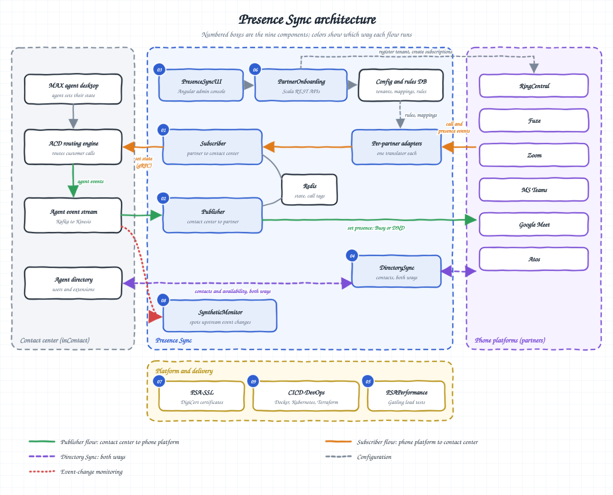
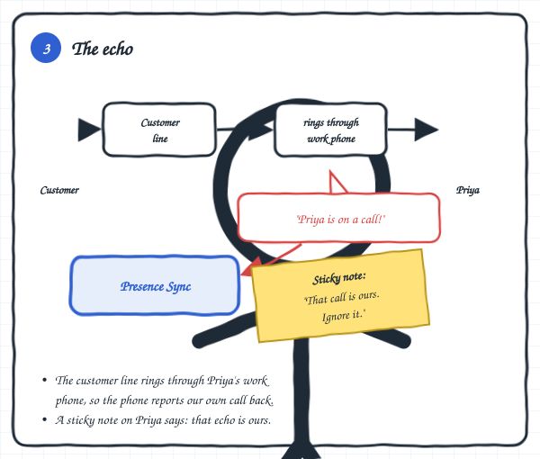

[← Presence Sync](README.md) · [All projects](../)

# Presence Sync: how it works

How the [Presence Sync story](README.md) works underneath, explained in plain words. The **contact center** sends customer calls to agents; the **phone platform** (RingCentral, Teams, Zoom and others) carries both customer and internal calls on one phone.

**Contents:** 
[1. Architecture](#architecture-the-big-picture) ·
[2. Contact center to phone](#contact-center-to-phone-platform) ·
[3. Phone to contact center](#phone-platform-to-contact-center) ·
[4. One call, end to end](#one-call-end-to-end) ·
[5. The echo](#the-echo) ·
[6. Signals](#signals-presence-sync-listens-to) ·
[7. Edge cases](#edge-cases-covered) ·
[8. Scaling](#scaling) ·
[9. Onboarding](#tenant-onboarding-the-ux-i-designed) ·
[10. Staying connected](#staying-connected) ·
[11. Debugging](#debugging-with-90-minutes-of-talk-time) ·
[12. Timeline](#timeline-how-it-grew) ·
[13. Partners](#supported-partners)

## Architecture: the big picture

- Two services carry status in opposite directions: one from the contact center to the phone platform, one back.
- A small translator per phone platform turns each platform's messages into one common format.
- A directory service keeps contacts in step on both sides; an admin console and an onboarding service set everything up; a monitor watches for upstream changes.

## Contact center to phone platform

- When the contact center gives Priya a customer, Presence Sync marks her as busy on her phone platform.
- Each agent has a **rule** that decides how sync works:
  - **Contact center to phone:** a customer call makes her "Busy" (other calls can still ring) or "Do Not Disturb" (nothing else rings).
  - **Phone to contact center:** a call on her work phone stops new customers from reaching her.
  - **Both ways:** both of the above, in the same call.
- When the customer call ends, her phone status goes back to what it was.

## Phone platform to contact center

- When a colleague calls Priya on her work phone, Presence Sync tells the contact center not to send her customers.
- If she's in the middle of a customer conversation, the change waits until that conversation ends, so nothing is cut off.
- If she set her own status (for example, Lunch), her choice always wins.
- Agents who handle several channels at once (voice, chat, email, social) only stop receiving voice calls; their other channels keep flowing.

## One call, end to end

- **A customer call:** the customer reaches Priya; her phone shows Busy until the call ends, then goes back to Available.
- **An internal call:** a colleague rings Priya; the contact center stops sending her customers until she hangs up.
- **Both in one call:** Priya brings a colleague into a customer call. Each person's status is tracked separately, so when Priya drops off, only she becomes free.

## The echo

- Customer calls ring through the same work phone, so the phone reports our own customer call back to us.
- A "sticky note" on the agent tells the system to ignore that echo. If the sticky note is late, a check on the calling number catches it.

## Signals Presence Sync listens to

- From the **contact center:** the agent goes available or away, a customer call starts or ends.
- From the **phone platform:** a call connects or ends, Do Not Disturb turns on or off, the agent's status changes.

## Edge cases covered

- An agent on Lunch goes back to Lunch after a call, not to Available.
- With Do Not Disturb on the phone platform, calls go to voicemail and nothing changes.
- Agents who appear offline or invisible on the phone platform are still synced.
- Agents without a rule are left alone.
- One platform sends an extra "call connected" signal when a customer hangs up; the system ignores it.

## Scaling

- Customers (tenants) are spread across servers, and each server handles only its own tenants.
- Adding capacity means adding servers.

## Tenant onboarding: the UX I designed

- A customer's admin connects their phone platform account, the system checks the data, matches each contact-center agent to their phone user, assigns rules, and sync starts automatically.
- I designed the onboarding flow and mockups; UI engineers built the screens.
- **Directory sync:** agents can see which teammates are free, across a team or the whole company, so they can bring one into a customer call.

## Staying connected

- Each phone platform's connection expires regularly. The system renews connections and access tokens before they lapse, separately for each customer, so one customer's problem never affects another.

## Debugging with 90 minutes of talk time

- Real test calls were limited to 90 minutes in total.
- We copied test events from the development environment to our own machines, so we could replay and debug them without making new calls.
- A monitor watched for unannounced changes from the upstream team and warned us before they caused problems.

## Timeline: how it grew

- **2017:** first and only engineer; use cases and first versions.
- **2018 - 2019:** two-way sync services, the first phone platform, onboarding design.
- **2020 - 2022:** more platforms, a common translator design, directory sync, move to containers and infrastructure as code.
- **2022:** handover to the team.

## Supported partners

RingCentral, Fuze, Zoom, Microsoft Teams, Google Meet and Atos, in the order they were added.

---

*Written from my own experience and in my own words. It describes the problem and the design ideas, not NICE's internal documents or code.*
