[← Presence Sync](README.md) · [All projects](../)

# Presence Sync: deep dive

The technical detail behind the [Presence Sync story](README.md). In these diagrams, **ACD** is the contact center's routing engine (NICE inContact), **MAX** is the agent's contact-center desktop, and **UC** or **partner** is the phone platform (RingCentral, Teams, Zoom and others).

**Contents:** 
[1. Architecture](#architecture-the-big-picture) ·
[2. Publisher flow](#publisher-flow-acd-to-uc) ·
[3. Subscriber flow](#subscriber-flow-uc-to-acd) ·
[4. One call, end to end](#one-call-end-to-end) ·
[5. Agent leg and the echo](#agent-leg-and-the-echo) ·
[6. Events](#events-psa-reacts-to) ·
[7. Edge cases](#edge-cases-covered) ·
[8. Scale-out](#scale-out-tenant-sharding) ·
[9. Onboarding](#tenant-onboarding-the-ux-i-designed) ·
[10. Subscriptions](#subscription-lifecycle-ringcentral-example) ·
[11. Debugging](#debugging-with-90-minutes-of-talk-time) ·
[12. Timeline](#timeline-how-it-grew) ·
[13. Partners](#supported-partners)

## 1. Architecture: the big picture

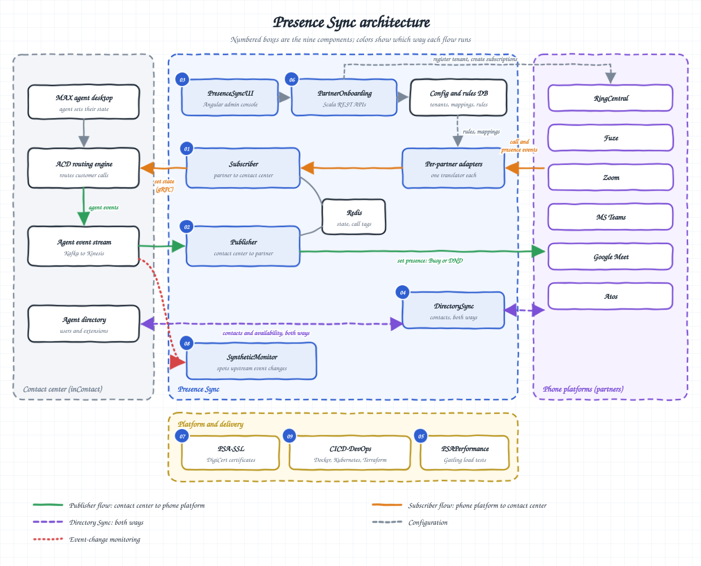

- **Contact center (grey):** MAX, the ACD routing engine, the agent event stream (Kafka to Kinesis) and the agent directory.
- **Presence Sync (blue):** the Publisher and Subscriber services, the per-partner adapters, Redis, DirectorySync, the onboarding stack (PresenceSyncUI and PartnerOnboarding) and the SyntheticMonitor.
- **Platform and delivery (gold):** PSA-SSL, CICD-DevOps and PSAPerformance.
- **Phone platforms (purple):** the six partners.

> **Say it like this:** "Two independent services. The Publisher pushes contact-center state out to the phone platform; the Subscriber takes phone-platform events and sets contact-center state. The ACD still does skill-based routing. PSA decides whether an agent can be routed at all."

## 2. Publisher flow: ACD to UC


**Three rule types.** Every agent is assigned a rule, and its type decides which direction PSA syncs:

| Rule type | Direction | Example |
|---|---|---|
| **Publisher** | ACD → partner | A customer calls. PSA sets Priya's MAX state to Working and her partner presence to Busy or DND, depending on the rule. With **DND**, no other calls come through. With **Busy**, other calls still ring, and she can decline the new call, or hold the first one and answer. This is the typical customer-care setup. |
| **Subscriber** | Partner → ACD | An internal call: a colleague dials Priya's extension about lunch, or to add her to a customer call (cold or warm transfer). The event carries the extension as the number. PSA sets Priya's MAX state to Unavailable-UC, so no customer calls reach her. |
| **Bidirectional** | Both | A Publisher rule and a Subscriber rule combined: both flows happen within the same call. |

> **Say it like this:** "One actor per partner, per tenant and per agent, so one tenant's problem stays in that tenant. Smallest-mailbox routing for throughput, and consistent hashing so each agent's state changes are applied in order."

## 3. Subscriber flow: UC to ACD


**Channels.** A business unit (one tenant, such as one customer-care center) handles voice, chat, email and social.
- **Single-channel agents** work one channel at a time. PSA supported every channel, with voice as the priority.
- **Omnichannel agents** work several channels at once. State changes apply to voice. If an omnichannel agent changes their partner status to focus on chat, email or social, PSA sets their MAX state to Unavailable-UC: no customer voice calls reach them, and the other channels keep flowing.

> **Say it like this:** "Every partner speaks a different protocol, so each one gets its own inbound adapter. After that, all partners share one generic workflow. The hardest rule is ownership: PSA only undoes what PSA did."

## 4. One call, end to end

**Publisher rule: a customer call**

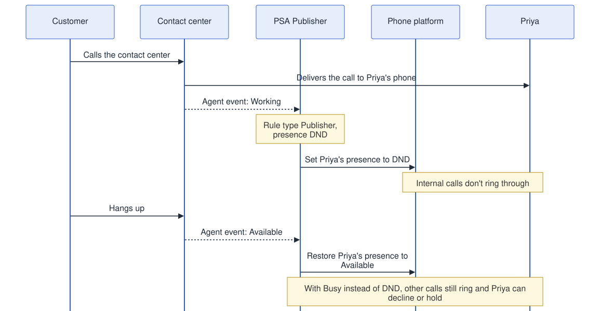

**Subscriber rule: an internal call**

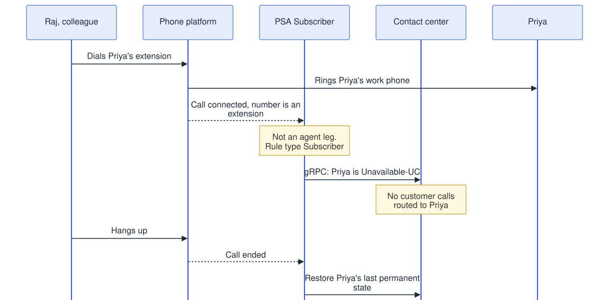

**Bidirectional rule: a customer call with a colleague added**

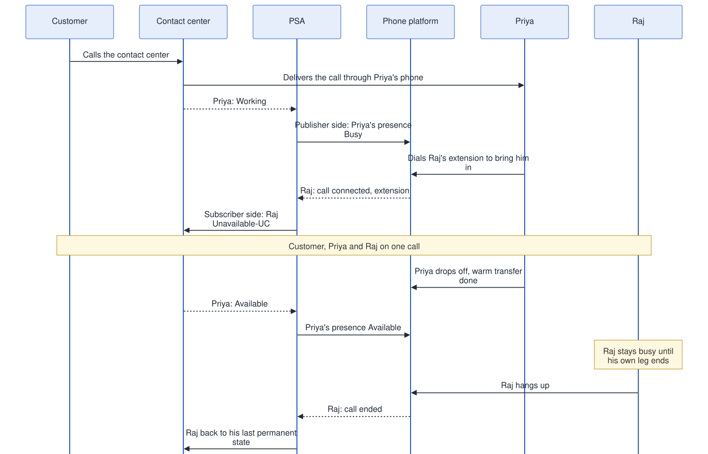

> **Say it like this:** "PSA tracks state per agent leg, not per call. In conferences and transfers, people join and drop at different times, so each person is set and reset on their own. No 'get state' calls on the hot path: state lives in Redis, and after a call the agent goes back to their last permanent state, so Lunch stays Lunch."

## 5. Agent leg and the echo

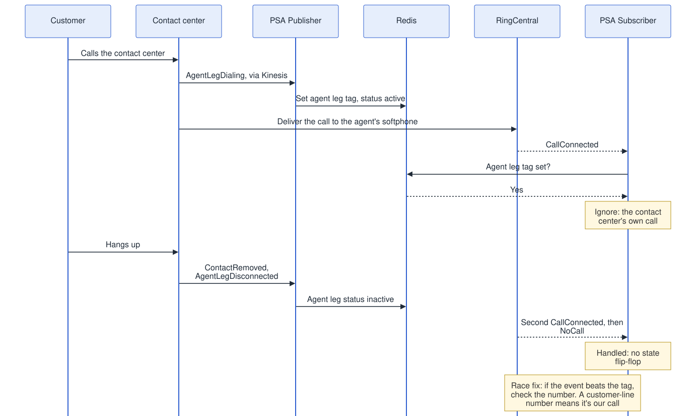

- The contact center delivers customer calls through the agent's own softphone (the **agent leg**), so the partner reports our own call back to us as an ordinary phone call.
- When the ACD starts an agent leg, the Publisher tags the agent in Redis, and the Subscriber ignores telephony events while the tag is set.
- **The race:** the partner's event can arrive before the tag is in place. The backup check compares the call's number with the tenant's configured customer-line numbers; a match means it's our own call.

> **Say it like this:** "The tag is the fast path, a local Redis lookup with no call to the partner. The number check is the safety net for the race."

## 6. Events PSA reacts to

| Source | Event or field | What it means |
|---|---|---|
| ACD | Online / Offline | Agent Available or Unavailable, with an away-state ID such as Lunch |
| ACD | AgentLegDialing | The ACD is delivering a contact to the softphone; the agent leg becomes active |
| ACD | ContactDelivered / ContactRemoved | The contact reaches the agent, or ends |
| ACD | AgentLegDisconnected | The agent leg becomes inactive |
| Partner | Telephony status | CallConnected or NoCall; used in every use case |
| Partner | DND status | TakeAllCalls or DoNotAcceptAnyCalls; DND cases only |
| Partner | Direction | Inbound or Outbound; DND cases with no call |
| Partner | Termination type | final; only when a call ends |
| Partner | presenceStatus | Available, Busy, DND, Offline or Invisible |

## 7. Edge cases covered

| Case | What PSA does |
|---|---|
| **Last permanent state** | An agent on Lunch goes to Unavailable-UC for the call, then back to Lunch afterwards, not to Available. |
| **DND on the partner side** | The incoming call goes to voicemail; no state change. |
| **Invisible or Offline on the partner side** | Calls are still synced. |
| **Agent without a rule** | No action. |
| **RingCentral's second CallConnected** | RingCentral sends a second CallConnected when the customer hangs up; PSA handles it without flipping the agent's state. |

## 8. Scale-out: tenant sharding


- Redis holds the node registry and which node owns which business unit (tenant).
- Each node's Node Manager processes only its own tenants; adding capacity means adding nodes.
- Configuration changes from the PSA APIs reach every node through SNS.

## 9. Tenant onboarding: the UX I designed


- I designed the onboarding flow and mockups; UI engineers built them in Angular (PresenceSyncUI) on the PartnerOnboarding APIs.
- Partner setup steps differ by platform; the first box shows RingCentral's.

**Directory Sync.** After Presence Sync launched, agents still had no agent-level view of who was available, across a team or a whole tenant. They needed one to add a teammate to a customer call. I designed DirectorySync to fill that gap, syncing contacts both ways:


- **Account mapping per partner:** a tenant can take presence from one platform and its directory from another (for example, presence from RingCentral and directory from MS Teams), so each gets its own account mapping.
- **Admin levels:** the contact center's admin hierarchy (NICE admin, partner admin, customer tenant) belongs to the ACD team. NICE and partner admins can view a tenant's setup, but not register it or change its credentials.

## 10. Subscription lifecycle: RingCentral example


> **Say it like this:** "Lifecycle work runs per tenant inside its own actor, so an expired token or a failed renewal affects one tenant, not the platform."

## 11. Debugging with 90 minutes of talk time

- Live test calls were capped at 90 minutes in total, about 10 to 15 minutes per partner.
- We mirrored dev events from partner R&D accounts to our own machines, so routine debugging stopped using up talk time.
- **A related problem:** the upstream contact-center team sometimes changed its events without notice, which broke PSA in Dev or Stage. The SyntheticMonitor watched those events in production and flagged changes before they caused problems.

## 12. Timeline: how it grew

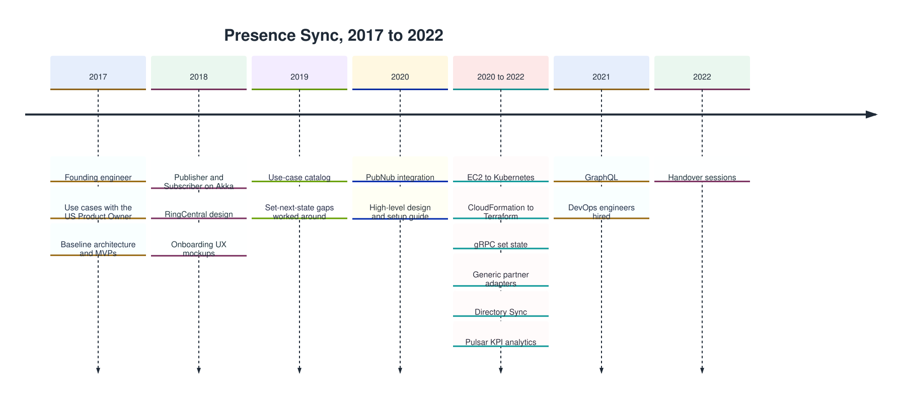

## 13. Supported partners

In the order they were added:

1. RingCentral
2. Fuze
3. Zoom
4. Microsoft Teams
5. Google Meet
6. Atos

---

*Written from my own experience and in my own words. It describes the problem and the design ideas, not NICE's internal documents or code.*
